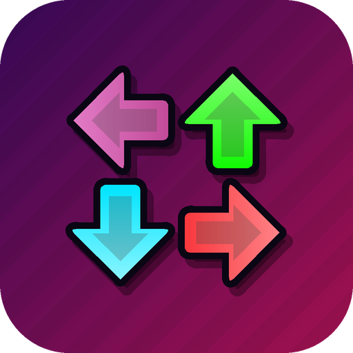

<div align="center">



# V-Converter

**Convert Friday Night Funkin' mods between Psych Engine, V-Slice and Codename Engine.**

[](https://github.com/BrenninhoTools/V-Converter/actions/workflows/build.yml)


</div>

> [!NOTE]
> **This app was vibe coded.** V-Converter was built through vibe coding: the code was written with an AI assistant (Claude) from prompts, then tested and checked against the engines' source code. Conversions are validated, but expect rough edges, and please [open an issue](https://github.com/BrenninhoTools/V-Converter/issues) if something breaks.

A remake of the V-Slice converter as a native app written in Kotlin, for **Android** and **Windows**. It converts content from **Psych Engine** and **Codename Engine** to **V-Slice** (the current base game), from V-Slice back to Psych, and between Psych and Codename in both directions.

## Contents

- [Download](#download)
- [Supported conversions](#supported-conversions)
- [Generator](#generator) · [Chart Editor](#chart-editor) · [Character Editor](#character-editor) · [Stage Editor](#stage-editor)
- [Psych → V-Slice](#psych--v-slice) · [V-Slice → Psych](#v-slice--psych) · [Codename → V-Slice](#codename--v-slice) · [Codename → Psych](#codename--psych) · [Psych → Codename](#psych--codename)
- [Building](#building)

## Download

Every push to `main` is built by [GitHub Actions](https://github.com/BrenninhoTools/V-Converter/actions/workflows/build.yml). Open the latest successful run and grab one of its artifacts:

| Artifact | Platform | What it is |
| --- | --- | --- |
| `V-Converter-release` | 📱 Android | Optimized APK (R8), the fastest one to use |
| `V-Converter-debug` | 📱 Android | Debug APK, for testing |
| `V-Converter-windows-installer` | 🪟 Windows | `.msi` and `.exe` installers |
| `V-Converter-windows-portable` | 🪟 Windows | Portable folder, no install needed |

## Supported conversions

| Module | Psych → V-Slice | V-Slice → Psych | Codename → V-Slice | Codename → Psych | Psych → Codename |
| --- | :---: | :---: | :---: | :---: | :---: |
| Whole mod (folder / .zip / .rar / .7z) | ✅ | ✅ | ✅ | ✅ | ✅ |
| Charts | ✅ | ✅ | ✅ | ✅ | ✅ |
| Characters | ✅ | ✅ | ✅ | ✅ | ✅ |
| Stages | ✅ | ✅ | ✅ | ✅ | ✅ |
| Weeks ↔ Levels | ✅ | ✅ | ✅ | ✅ | ✅ |
| Scripts | ✅ | ✅ | ✅ | ✅ | ✅ |

| Direction | Scripts |
| --- | --- |
| Psych → V-Slice | Lua / HScript → `.hxc` |
| V-Slice → Psych | `.hxc` → Psych HScript |
| Codename → V-Slice | Codename HScript → `.hxc` |
| Codename → Psych | Codename HScript → Psych HScript |
| Psych → Codename | Lua / HScript → Codename HScript |

The Android app has two sections, switched at the top: **Converter** and **Generator** (new V-Slice content from scratch). In the Converter, pick the source engine (**Psych**, **Codename** or **V-Slice**) and the target engine in the bridge at the top of each tab; tapping the **To** card or the swap button switches the target. On Windows the engines are picked in the sidebar, and files or mods can be dragged into the window. Both apps use an original FNF-style icon (a microphone and the four arrows) and the custom cursor from `assets/images/cursor/cursor.png` (on Android it shows with a mouse or trackpad, and where you touch the screen unless "Touch Cursor" is turned off in the options) show an `FPS:` counter in the top-right corner and play `assets/music/freakyMenu.ogg` as menu music (paused while the Chart Editor plays a song) and `assets/sounds/scrollMenu.ogg` when tabs and buttons are clicked; the counter, the sounds, the music and its volume are set in the options (the gear in the top-right corner).

## Generator

| Tab | Creates |
| --- | --- |
| Mod | `_polymod_meta.json`, `_polymod_icon.png` and an optional starter module script |
| Chart | The [Chart Editor](#chart-editor): start a song or open any chart and edit it to the music |
| Character | The [Character Editor](#character-editor): open any character or a spritesheet and fix its animations and offsets |
| Stage | The [Stage Editor](#stage-editor): open any stage or start from your images and lay it out with the game camera in view |
| Level | `data/levels/<id>.json` with songs, background color, title image and base or custom menu characters |
| Script | `.hxc` classes: Module, Song, Stage, Character, Song event (with Chart Editor fields) and Note kind, with the callbacks you pick |

Every tab can download the result as a `.zip` or write it into the mod folder.

## Chart Editor

The **Chart** tab of the Generator on Android, and **Chart Editor** in the sidebar on Windows.

- **New or existing charts**: start a song from a name, BPM and difficulties, or open V-Slice `<song>-metadata.json` + `<song>-chart.json`, Psych chart `.json` files or a Codename song (`meta.json` + `charts/*.json`). Folders and `.zip`/`.rar`/`.7z` archives work too, and `Inst`/`Voices` audio found next to the charts is loaded with them.
- **Note grid**: a V-Slice style checkerboard with the strumline on top, notes, holds and receptors drawn with the base game sprites from `assets/images/ui/NOTE_assets.png`, opponent lanes on the left, player lanes on the right and the event lane last, with events shown with `assets/images/ui/charter/event.png`. Tap/click a lane to place a note snapped to the grid (1/4 up to 1/192), tap it again to select it and once more to delete it. Selected notes get a hold length and a note kind (`alt`, `hurt`…). Drag or use the mouse wheel to scroll, zoom in and out, jump by measures, undo and redo from the toolbar, and tap or drag the mini-map next to the grid to jump around the song. On wide screens the grid sits between the side panels; on phones the panels are tabs under it.
- **Music**: plays the instrumental with the voices mixed in (one shared voices file or split player/opponent), with optional hitsounds while the chart scrolls past the strumline. Without audio the chart still plays at its BPM.
- **Events and BPM**: `FocusCamera`, `PlayAnimation`, `ZoomCamera`, `ScrollSpeed` and `SetCameraBop` with their own fields, or any custom event with a JSON value. BPM and time signature changes go on the timing list; the grid follows them.
- **Difficulties**: add empty or copied difficulties, remove them, mirror or clear notes and set the scroll speed of each one. The song info (name, artist, charter, characters, stage, note style, offset, variation) is edited in place.
- **Export**: V-Slice (`data/songs/<id>/` + `songs/<id>/` audio), Psych Engine (`data/<id>/` charts and `events.json`, `songs/<id>/Inst.ogg` and `Voices*.ogg`) or Codename Engine (`songs/<id>/meta.json`, `charts/` and `song/` audio, with the strumlines pointed at split voices), as a `.zip` or straight into a mod folder.

On Windows: <kbd>Space</kbd> plays, <kbd>Ctrl</kbd>+<kbd>Z</kbd> / <kbd>Ctrl</kbd>+<kbd>Y</kbd> undo and redo, <kbd>Q</kbd> / <kbd>E</kbd> shorten and lengthen the selected hold, <kbd>Delete</kbd> removes the selection, <kbd>Page Up</kbd> / <kbd>Page Down</kbd> jump a measure.

## Character Editor

The **Char** tab of the Generator on Android, and **Character Editor** in the sidebar on Windows.

- **Open anything**: a V-Slice or Psych character `.json` or a Codename character `.xml`, together with its spritesheet `.png` + `.xml` (folders and archives work too). A spritesheet alone starts a new character with the animations guessed from the frame names (`idle`, `singLEFT`…, misses, `danceLeft`/`danceRight`).
- **Animation preview**: plays every animation from the spritesheet with its frame rate, loop and indices, frame by frame if you want, drawn the way V-Slice places characters (feet on the floor line, offsets scaled with the sprite).
- **Offsets**: drag the sprite or use the arrow buttons to move the selected animation, with a ghost of the idle (or any other animation) behind it. Undo and redo cover every change.
- **Character settings**: side (player, opponent, girlfriend), scale, position, camera offset (dragged on the preview too), flip X, pixel art, health icon, sing time, dance rate and starting animation.
- **Export**: V-Slice (`data/characters/<id>.json` + `images/…`), Psych Engine (`characters/<id>.json`, offsets and position converted for the chosen side) or Codename Engine (`data/characters/<id>.xml` + `images/characters/…`), always with the spritesheet.

On Windows: <kbd>Space</kbd> plays, the arrow keys move the offset (<kbd>Shift</kbd> for 10), <kbd>W</kbd> / <kbd>S</kbd> pick the animation, <kbd>,</kbd> / <kbd>.</kbd> step frames, <kbd>G</kbd> toggles the ghost and the mouse wheel zooms.

## Stage Editor

The **Stage** tab of the Generator on Android, and **Stage Editor** in the sidebar on Windows.

- **Open anything**: a V-Slice or Psych stage `.json` (with its `.lua` when it builds sprites there) or a Codename stage `.xml`, together with the stage images; opening a whole mod folder or archive finds every image the stage uses. A new stage starts with the base game character positions.
- **Layout**: every prop drawn with its image (the first frame for animated Sparrow props), scale, scroll factor, alpha, angle and flips, plus boxes for the player, opponent and girlfriend at their feet position with their camera points. A dashed frame shows the game camera at the stage's zoom, and parallax follows the scroll factors as you move the view.
- **Editing**: tap or click to select, drag to move, arrow buttons to nudge, layers sorted by `zIndex` with bring forward / send back, duplicate and delete, solid color props, images added from `.png` (+ `.xml` for animations), stage name, zoom and library. Undo and redo cover every change.
- **Export**: V-Slice (`data/stages/<id>.json`), Psych Engine (`stages/<id>.json` plus a Lua script for what Psych JSON can't hold) or Codename Engine (`data/stages/<id>.xml`), always with the images in `images/`.

On Windows: the arrow keys nudge the selection (<kbd>Shift</kbd> for 10), <kbd>Page Up</kbd> / <kbd>Page Down</kbd> change its layer, <kbd>Ctrl</kbd>+<kbd>D</kbd> duplicates, <kbd>Delete</kbd> removes a prop and the mouse wheel zooms.

---

## Psych → V-Slice

The main converter. Each part below has its own tab in the app.

## Whole mod

The **Mod** tab converts an entire Psych Engine mod in one go, from its folder or from a `.zip`, `.rar` (RAR4 and RAR5) or `.7z` archive. The mod root is found automatically even when the archive wraps it in extra folders. Older mods shipped as a whole engine build work too: `assets/preload/`, `assets/shared/`, `assets/week*/`, `assets/base_game/` and `assets/songs/` are merged as if they were a `mods/` folder.

- `data/<song>/` charts (+ `events.json`) → `data/songs/<song>/`
- `characters/`, `stages/`, `weeks/` → `data/characters/`, `data/stages/`, `data/levels/`
- `images/`, `songs/`, `music/`, `sounds/`, `fonts/`, `videos/`, `shaders/` copied as-is
- Split vocals (`Voices-Player.ogg`, `Voices-Opponent.ogg` or a character's `vocals_file`) are wired through `playerVocals` / `opponentVocals`, so audio files keep their names
- Character slots are inferred from how the charts use each character
- Placeholder folders that hold nothing but a single text file (like a template's `readme.txt`) are left out automatically, in both directions
- `pack.json` / `pack.png` → `_polymod_meta.json` / `_polymod_icon.png`
- Lua and HScript scripts (`scripts/`, `data/<song>/`, `stages/`, `custom_events/`, `custom_notetypes/`) → `scripts/modules/*.hxc`
- A chart's custom `arrowSkin` (and `splashSkin`) → a V-Slice note style in `data/notestyles/` built from the same sheet; note types that set their own `texture` get a note style plus a `NoteKind` script that applies it
- Songs on a pixel stage (`isPixelStage` or `stageUI: "pixel"`) use the `pixel` note style

Every other tab also accepts archives and picks the files it needs from them.

## Charts

Pick one or more Psych Engine charts (`song-easy.json`, `song.json`, `song-hard.json`, …) with their `events.json`; several songs at once work too. The app writes a V-Slice song folder:

```
<song-id>/
├── <song-id>-metadata.json
├── <song-id>-chart.json
├── <song-id>-metadata-erect.json   (only when a difficulty needs its own variation)
└── <song-id>-chart-erect.json
```

Drop that folder inside `data/songs/` of your V-Slice mod.

### The Charts tab

The same Charts tab is used for every direction (Psych ↔ V-Slice, Codename → V-Slice, Codename ↔ Psych), on Android and on Windows:

1. **Files**, grouped by song. Psych difficulties can be renamed in place (handy for `song-insane.json` style names).
2. **Preview**: a minimap of the whole chart with the opponent and player lanes (and girlfriend lanes when used), holds, camera focus, BPM and time signature changes and events, with a zoom toggle. After converting, switch between the source and the converted chart: the app checks that every note, hold and BPM change made it across.
3. **Options**: song name, artist, charter, characters, stage, note style and scroll speed per difficulty (empty fields keep what the chart uses), plus a switch to keep or drop Psych-only events. Only the options the target engine has are shown.
4. **Convert** and save, like the other tabs.

### What gets converted

- Both the legacy format (pre-1.0, `mustHitSection` relative lanes) and `psych_v1` (absolute lanes)
- Every difficulty merged into one chart, each with its own scroll speed
- Difficulties with their own BPM, time signatures, events, characters or stage are not flattened: they become a V-Slice variation (`erect` for erect/nightmare charts), and the whole-mod converter copies the `Voices` files with the variation suffix V-Slice looks for
- BPM changes and time signatures (sections of 3, 6, 7… beats) rebuilt from section lengths into `timeChanges`
- The chart's `offset` becomes the metadata's instrumental offset (and back, V-Slice → Psych)
- Camera focus from `mustHitSection` / `gfSection` → `FocusCamera`
- Psych events:
  - `Hey!` → `PlayAnimation` (`hey`)
  - `Play Animation` → `PlayAnimation`
  - `Camera Follow Pos` → `FocusCamera` (position or back to section focus)
  - `Change Scroll Speed` → `ScrollSpeed` (relative, duration converted to steps)
- Note types → note kinds (`Alt Animation` → `alt`, `Hurt Note` → `hurt`, `Hey!` → `hey`, `No Animation` → `noanim`, custom types → slugged id), and `altAnim` sections → `alt` on opponent notes
- Stacked duplicate notes are removed
- Stage ids mapped to the V-Slice ones (`stage` → `mainStage`, `spooky` → `spookyMansion`, …); `school`/`schoolEvil` or pixel arrow skins → `pixel` note style

Other Psych events get a V-Slice style id (`Flash Camera` → `FlashCamera`, never clashing with built-in ids like `FocusCamera`), applied the same way in charts and scripts, while converted scripts still receive the original name in `onEvent`. `custom_events/*.lua`/`.hx` become `scripts/events/<Name>Event.hxc` holding a `SongEvent` (Chart Editor entry with Value 1/Value 2) and a `Module` with the converted code. Built-in Psych events without a V-Slice event (`Add Camera Zoom`, `Screen Shake`, `Set Property`, `Play Sound`, `Set GF Speed`, `Alt Idle Animation`) get a `SongEvent` script there too. Anything that can't be converted yet is listed in the in-app report.

## Saving

Pick your V-Slice mod folder once (it is remembered). Converted files go straight to the right place:

```
<mod>/data/songs/<song-id>/<song-id>-metadata.json
<mod>/data/songs/<song-id>/<song-id>-chart.json
<mod>/data/characters/<id>.json
<mod>/data/stages/<id>.json
<mod>/data/levels/<id>.json
<mod>/scripts/modules/<Class>.hxc
```

## Characters

Pick Psych character `.json` files together with their spritesheet `.xml` files. With the XML the conversion is pixel-exact: V-Slice anchors characters at their feet (idle frame bottom-center) and scales animation offsets, while Psych anchors at the top-left of the first atlas frame, so offsets and camera are rebased using the real frame sizes.

- Animations, prefixes, indices, frame rate and loop
- Sparrow and multi-atlas (`multisparrow`) sheets
- Scale, flip, pixel (no antialiasing), health icon, sing duration, dance speed (`danceLeft`/`danceRight`)
- Camera position folded into `cameraOffsets`
- Slot (Player / Opponent / Girlfriend) decides how offsets are rebased
- `<anim>-loop` animations (played by Psych after `<anim>` ends) become V-Slice's `<anim>-hold`, which works the same way (and back, V-Slice → Psych)
- **Animate atlas characters** (`images/<image>/Animation.json` + `spritemap1.json`): Psych's symbol names (matched by prefix) become the exact symbol names V-Slice plays (`animType: "symbol"`), and the offsets include each symbol's bounds, read from `Animation.json` and the spritemap, so the atlas lands where Psych draws it. The same works Psych → Codename, V-Slice → Psych (frame label animations become indices of the main symbol, which is all Psych can play) and Codename → Psych

Not carried over: health bar colors and per-character vocal suffixes (V-Slice has no equivalent).

## Stages

Built against V-Slice's `Stage.hx` / `StageData.hx`, so the JSON loads and draws like Psych drew it:

- Character positions → V-Slice feet anchors, camera offsets (including Psych's built-in ±100/150 camera shifts) and zoom
- `directory` is always a real V-Slice asset library (`shared`, `week1`…): V-Slice stops with "Missing library" on unknown ones, and mod images load from `images/` anyway
- Psych 1.0 stage editor `objects` → props (sprites, animated sprites, solid squares), keeping layer order, scroll, scale, alpha, angle, color, flip and pixel mode; low-quality-only and hidden objects are left out
- Characters missing from the objects list go on top instead of disappearing; `hide_girlfriend` becomes an invisible girlfriend
- Scaled animated sprites: V-Slice multiplies animation offsets by the scale and keeps the hitbox offset, Psych replaces it. With the spritesheet `.xml` the offsets are recalculated so every animation lands on the exact Psych pixel (the starting animation too)
- Animated sprites without animations show the spritesheet's first frame, like Psych
- Stage Lua is read: sprites it creates become props, and beat bops (`if curBeat % N == 0 then playAnim(...)`, danceLeft/danceRight alternation, `onStepHit` bops) become `danceEvery`, with the bop animation renamed to `idle` when needed. Lua `addOffset`, `setBlendMode` and frame-index `addAnimation` (Packer sheets) on stage objects are folded in, and those lines leave the converted script
- Girlfriend scroll factor (0.95) preserved

Stages built only in code have no object list; their character layout converts, base Psych stages point to their V-Slice twin (`stage` → `mainStage`…) and the report lists the images to recreate as props.

## Weeks

- Songs (ids in Psych's song path format), story name, background (`menubackgrounds/menu_<name>` or the default yellow) and title image (`storymenu/<week>`)
- Menu characters from `images/menucharacters/*.json` → level props, placed where Psych draws them; base `dad`/`bf`/`gf` map to V-Slice's own props
- Hidden story weeks → `visible: false`
- Lock chains and freeplay hiding → a level script (`scripts/levels/<Week>Level.hxc`): the level unlocks after beating `weekBefore`, stays hidden until then when `hiddenUntilUnlocked` is set, keeps its songs out of freeplay while locked (like Psych) and hides them for good with `hideFreeplay`

Not carried over: per-song freeplay icons/colors (V-Slice shows the opponent's pixel icon; listed in the report).

## Scripts

The **Scripts** tab (and the Mod tab) turns Psych Engine scripts into V-Slice scripted classes (`.hxc`).

- **Lua** is fully parsed (Lua 5.1 / LuaJIT syntax) and transpiled to HScript: locals, globals, closures, varargs, tables (arrays and maps), `pairs`/`ipairs`, numeric loops, `goto continue`, `and`/`or` with Lua truthiness, and the `string`, `table`, `math`, `os` and `bit` libraries, including Lua patterns (`find`, `match`, `gmatch`, `gsub`, `format`)
- **Psych HScript** (`.hx`) is wrapped into a module: imports are mapped (`states.PlayState` → `funkin.play.PlayState`, …), and `game.boyfriend`, `camFollow`, `defaultCamZoom`, `Conductor.songPosition`, `curBeat`, `ClientPrefs`… are rewritten to their V-Slice equivalents
- Every script becomes a `Module` that only runs where Psych would run it: its song (`data/<song>/`), its stage (`stages/`), charts that use its event (`custom_events/`) or note type (`custom_notetypes/`), or everywhere (`scripts/`)
- Psych callbacks are hooked to V-Slice events: `onCreate`, `onCreatePost`, `onUpdate`, `onBeatHit`, `onStepHit`, `onSectionHit`, `goodNoteHit`, `opponentNoteHit`, `noteMiss`, `noteMissPress`, `onEvent`, `onMoveCamera`, `onSpawnNote`, `onCountdownTick`, `onStartCountdown`, `onEndSong`, `onSongStart`, `onPause`, `onResume`, `onGameOver`, `onDestroy`, `onTimerCompleted`, `onTweenCompleted`, `onSoundFinished`; returning `Function_Stop` cancels the countdown and the song end like in Psych
- The output is plain V-Slice HScript: no Lua-style leftovers (no `Function_*` constants, no `psych("…")` dispatch, no `g_`/`l_` prefixes). Script names keep their own names (`onUpdate` becomes `onUpdateScript` where it would clash with a `Module` method), and Psych calls become real functions such as `makeSprite(...)`. No runtime or helper classes are added: each module carries native V-Slice/Flixel code for exactly the Psych functions it uses (Lua sprites and texts, `getProperty`/`setProperty` paths, tweens, timers, sounds, camera, health, score, strum notes, shaders, saves, shared variables). Scripts of the same mod can still reach each other's Lua sprites
- Every class, field and event the generated code touches was checked against the FunkinCrew/Funkin source

Animate atlas sprites (`makeFlxAnimateSprite`, `loadAnimateAtlas`, `addAnimationBySymbol(Indices)`), every shader getter/setter (int/bool arrays, `setShaderSampler2D`), camera scroll and follow-point helpers, gamepads (buttons and analog sticks), `getPixelColor`, `loadMultipleFrames`, `createInstance`/`addInstance`, `callMethodFromClass`, `addToGroup`/`removeFromGroup`, `directoryFileList`, `loadSong` and `startVideo` are converted too, for V-Slice and for Codename.

The report lists, line by line, anything a script uses that has no V-Slice equivalent (custom substates, `addLuaScript`/`addHScript`, `saveFile`/`deleteFile`, dialogue, metatables, `unspawnNotes` tricks) so those parts can be finished by hand.

---

## V-Slice → Psych

| Input | Output |
| --- | --- |
| `<song>-metadata.json` + `<song>-chart.json` | `data/<song>/<song>[-difficulty].json` (psych_v1): sections rebuilt from time changes (exact BPM changes), camera focus → `mustHitSection`/`gfSection`, note kinds → note types, `PlayAnimation`/`ScrollSpeed`/`ZoomCamera`/`FocusCamera` → Psych events |
| Variations (`-erect`…) | Their own Psych song (`<song>-erect`) with their own audio, in a freeplay-only week |
| `data/characters/<id>.json` (+ XML) | `characters/<id>.json`, positions and camera rebased exactly with the spritesheet |
| `data/stages/<id>.json` (+ images' `.xml`) | `stages/<id>.json` with stage-editor objects, layer order and character markers, plus `stages/<id>.lua` when needed: props with `danceEvery` bop on the beat (idle or danceLeft/danceRight), scaled animated props get V-Slice's offset math and start on their starting animation, props without one stay still, Packer animations, blend modes, and character scroll/alpha/angle; an invisible girlfriend becomes `hide_girlfriend` |
| `data/levels/<id>.json` | `weeks/<id>.json` + `images/menucharacters/*.json` for custom props |
| `.hxc` scripts | Psych HScript: modules → `scripts/`, songs → `data/<song>/`, stages → `stages/`, characters → `characters/`, song events → `custom_events/` (+ `.txt`), note kinds → `custom_notetypes/` |
| Mod | `pack.json`/`pack.png`, `Voices-<char>.ogg` → `Voices-Player.ogg`/`Voices-Opponent.ogg`, assets copied |

Round trips (Psych → V-Slice → Psych) keep notes, sections, events, stage positions and the on-screen character placement.

---

## Codename → V-Slice

| Input | Output |
| --- | --- |
| `songs/<song>/charts/<diff>.json` + `meta.json` + `events.json` | `<song>-metadata.json` + `<song>-chart.json`: player/opponent strumlines → lanes 0-3/4-7, note types → note kinds (`Alt Anim Note` → `alt` with a generated `NoteKind`), `BPM Change`/`Time Signature Change` → time changes, `Camera Movement`/`Camera Position` → `FocusCamera`, `Camera Zoom` → `ZoomCamera`, `Scroll Speed Change` → `ScrollSpeed`, `Camera Modulo Change` → `SetCameraBop`, `Play Animation` → `PlayAnimation` |
| Variants (`charts/<variant>/`, `meta-<variant>.json`) | V-Slice variations with their own `Inst-<variant>` audio |
| Other events (`Camera Flash`, `Add Camera Zoom`, `Camera Bop`, `HScript Call`, custom `data/events/*.json`) | Kept in the chart with named values, plus a `SongEvent` in `scripts/events/` (with a working implementation for the built-in ones) |
| `data/characters/<id>.xml` (+ spritesheet XML) | `data/characters/<id>.json`: offsets multiplied by the scale (Codename scales them, V-Slice does not), characters used on the other side mirrored like Codename does at runtime, `<id>-dead`/`gameOverChar` animations merged in for game over |
| `data/stages/<id>.xml` | `data/stages/<id>.json`: sprites, boxes, `high-memory` content, beat sprites (`danceEvery`), layer order and character spots; scaled sprites without `updateHitbox` are moved to where Codename draws them |
| `data/weeks/weeks/*.xml` + `data/weeks/characters/*.xml` | `data/levels/*.json` with menu props |
| `.hx` scripts | V-Slice modules scoped like Codename runs them (song, stage, stage extension, character, event, note type, global). `create`/`update`/`beatHit`/`onPlayerHit`/`onEvent`… become module events with Codename-style event objects; `boyfriend`, `camHUD`, `curBeat`, `Conductor.crochet`, stage sprites by name and so on are mapped to the V-Slice API |
| Mod | `_polymod_meta.json` from `data/config/modpack.ini`, `song/Inst.ogg`/`Voices*.ogg` moved to `songs/<song>/`, assets copied |

---

## Codename → Psych

| Input | Output |
| --- | --- |
| `songs/<song>/charts/<diff>.json` + `meta.json` + `events.json` | `data/<song>/<song>-<diff>.json` (Psych 1.0 format): strumlines → sections with `mustHitSection`/`gfSection` from `Camera Movement`, girlfriend strumlines → `GF Sing` notes or a hidden note type, note types renamed (`Alt Anim Note` → `Alt Animation`…), `BPM Change`/`Time Signature Change` → section BPM and beats, `Add Camera Zoom`, `Play Animation`, `Scroll Speed Change` → Psych events |
| Other events (`Camera Position`, `Camera Zoom`, `Camera Bop`, `Camera Flash`, `Camera Modulo Change`, `HScript Call`, custom ones) | `custom_events/<name>.hx` + `.txt`, with working Psych implementations for the built-in ones and the parameters packed into the two values |
| Variants | Their own Psych songs (`<song>-<variant>`), audio included |
| `data/characters/<id>.xml` | `characters/<id>.json`: offsets divided back from the scale, `holdTime` → `sing_duration`, camera offsets per side; character scripts converted |
| `data/stages/<id>.xml` | `stages/<id>.json` with objects, layers and character spots, plus `stages/<id>.hx` for beat dancers, blends, scroll/scale tweaks, `high-memory` content and stage extensions |
| `data/weeks/weeks/*.xml` + `data/weeks/characters/*.xml` | `weeks/*.json`, `weeks/weekList.txt`, `images/menucharacters/*.json`; songs outside every week go to a hidden-story freeplay week |
| `.hx` scripts | Psych HScript: `create`/`postCreate`/`update`/`beatHit`/`onPlayerHit`/`onDadHit`/`onEvent`/`onCountdown`… become Psych callbacks with Codename-style event objects (`event.cancel()` still works), `strumLines`, `stage.getSprite`, `FunkinSprite`, `CustomShader`, `Options`, `Conductor` and so on are mapped to Psych; a small `scripts/CodenameCompat.hx` recreates Codename-only camera settings when needed |
| Mod | `pack.json` from `data/config/modpack.ini`, `song/Inst.ogg`/`Voices*.ogg` moved to `songs/<song>/`, assets copied |

---

## Psych → Codename

| Input | Output |
| --- | --- |
| `data/<song>/<song>-<diff>.json` + `events.json` | `songs/<song>/charts/<diff>.json` + `meta.json`: opponent, player and (hidden) girlfriend strumlines, per-character vocals (`Voices-Player`/`Voices-Opponent`), section focus → `Camera Movement` (kept under forced camera positions), `Camera Follow Pos` → `Camera Position`, `Add Camera Zoom`, `Play Animation`, `Change Scroll Speed`, `Alt Idle Animation`, BPM and time signature changes |
| `Hey!`, `Set GF Speed`, `Screen Shake`, `Change Character`, `Set Property`, `Play Sound`, `Alt Idle Animation` | `data/events/<name>.hx` + `.json` reimplementing Psych's built-in events in Codename |
| Custom `arrowSkin`, note types with their own `texture` | A song script that swaps the note and strum sprites, and the note type texture copied to `images/game/notes/<type>`, where Codename looks for it |
| `Hurt Note`, `Hey!`, `GF Sing` note types | `data/notes/<name>.hx` (avoided by the CPU, health loss on hit, no miss when skipped; hey/cheer animations; sung by the girlfriend) |
| `characters/<id>.json` | `data/characters/<id>.xml`: offsets divided by the scale, `sing_duration` → `holdTime`, camera offsets per side, spritesheets outside `images/characters/` copied there |
| `stages/<id>.json` (+ `stages/<id>.lua`) | `data/stages/<id>.xml` with sprites, boxes, quality filters (`low-memory`/`high-memory`), character spots and the pixel extension; sprites made in the stage Lua move into the XML and the rest of the Lua becomes `data/stages/<id>.hx` |
| `weeks/*.json` + `images/menucharacters/*.json` | `data/weeks/weeks/*.xml` (song folders with display names), `data/weeks/weeks.txt`, `data/weeks/characters/*.xml`, `data/config/freeplaySonglist.txt` |
| Lua and HScript | Codename HScript: Psych callbacks are bridged from Codename's (`goodNoteHitPre` → `onPlayerHit` with `return Function_Stop` cancelling), Lua sprites become shared `public var`s, `getProperty`/`setProperty`/tweens/timers/cameras/text/shaders/sounds/saves come with small Psych helper functions, `runHaxeCode` blocks are converted inline, `mustHitSection` reads the chart's camera events. Song scripts go to `songs/<song>/scripts/`, global ones to `songs/`, custom events to `data/events/`, note types to `data/notes/` |
| Mod | `data/config/modpack.ini` from `pack.json`, audio moved to `songs/<song>/song/`, `pack.png` → `icon.png`, assets copied |

---

## Building

Android (debug and release APKs):

```
./gradlew assembleDebug assembleRelease
```

Release APKs are signed with the keystore in `keystore/` (`v-converter.jks`, settings in `keystore/keystore.properties`), so every release build has the same signature and installs as an update over the previous one. Builds made before the keystore was added were signed with a debug key: uninstall that version once before installing a new release APK. The keystore is public in this repository, so anyone can sign an APK with it; only install the APKs from this repository's Actions runs.

Windows (installers and portable app, run on Windows with JDK 17):

```
./gradlew :desktop:packageMsi :desktop:packageExe :desktop:createDistributable
```

The Windows app is a [Compose Multiplatform](https://www.jetbrains.com/compose-multiplatform/) build that shares every converter with the Android app.

### Credits

- Archives are extracted with `java.util.zip` (ZIP) and [7-Zip-JBinding-4Android](https://github.com/omicronapps/7-Zip-JBinding-4Android) / [7-Zip-JBinding](https://sevenzipjbind.sourceforge.net/) on Windows (RAR, RAR5, 7z)
- The Windows Chart Editor plays `.ogg` and `.mp3` with [VorbisSPI](https://github.com/pdudits/soundlibs) and MP3SPI
- The UI uses the Friday Night Funkin' style font in `assets/fonts/funkin.ttf`

## References

- [FunkinCrew/Funkin](https://github.com/FunkinCrew/Funkin)
- [ShadowMario/FNF-PsychEngine](https://github.com/ShadowMario/FNF-PsychEngine)
- [CodenameCrew/CodenameEngine](https://github.com/CodenameCrew/CodenameEngine)
